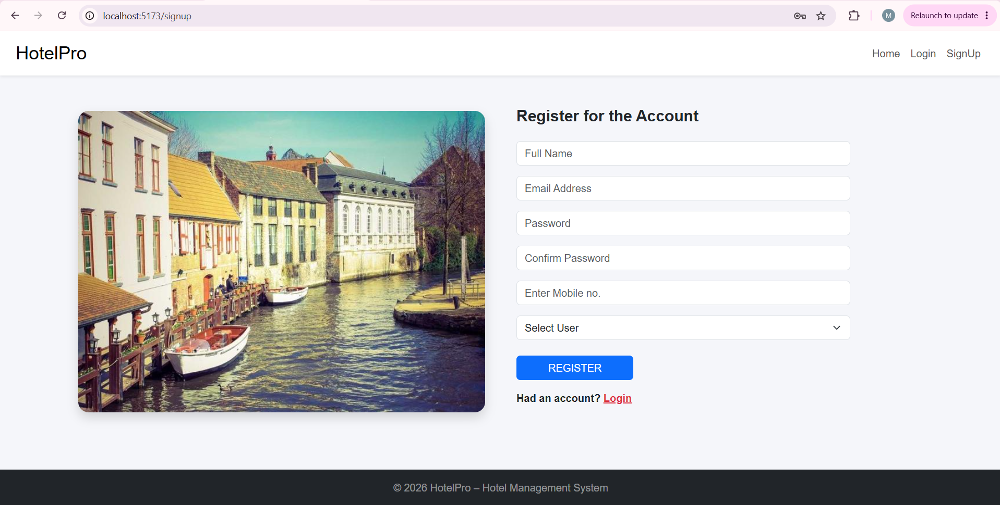
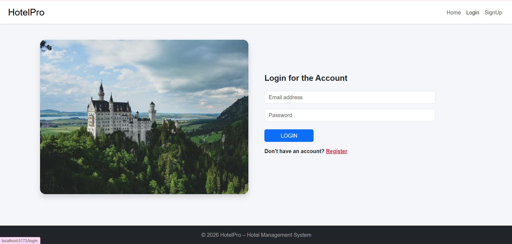
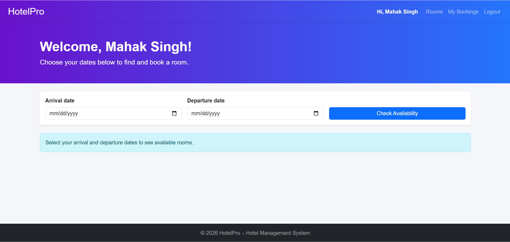
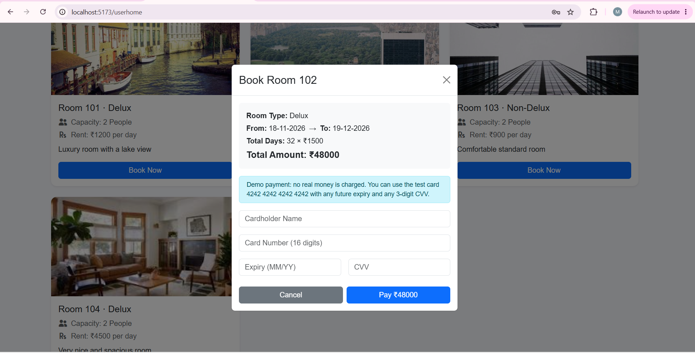
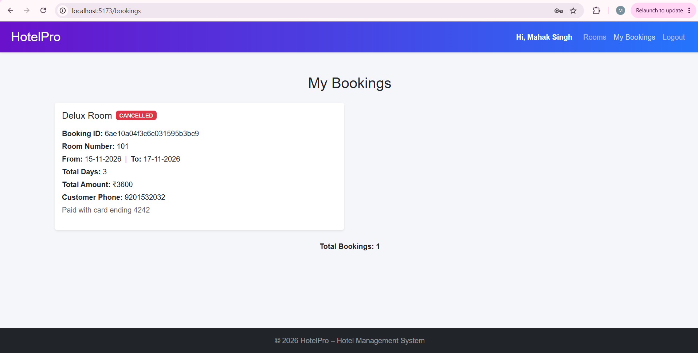
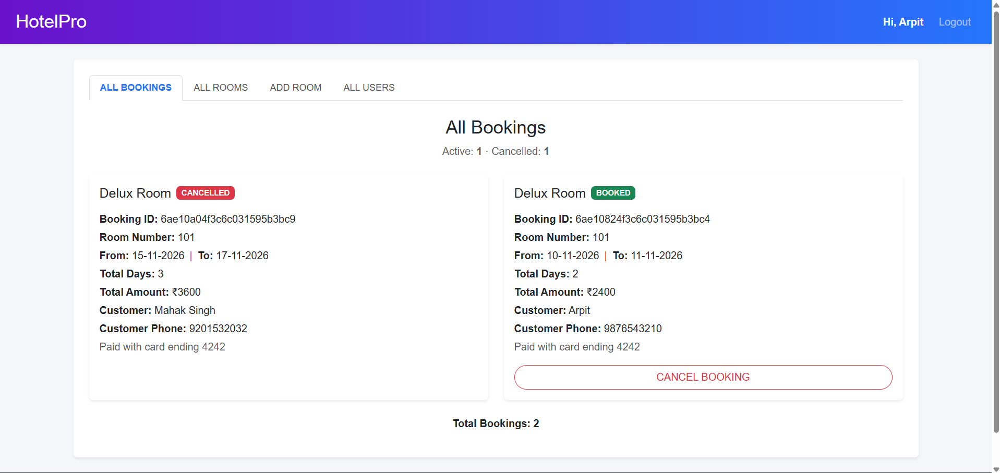
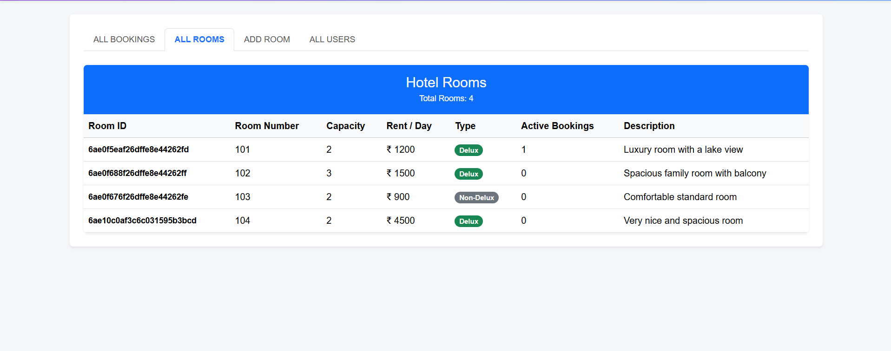
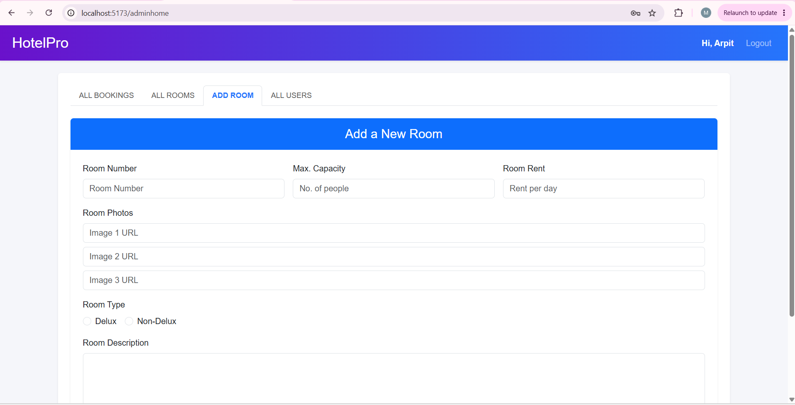
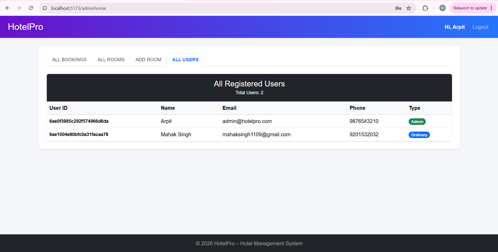

# HotelPro – Hotel Management System (MERN)

A full-stack hotel room booking system where customers can browse and book rooms by date, and admins can manage rooms, bookings and users.

## Tech Stack
- **Frontend:** React (Vite), React Router, React-Bootstrap, Bootstrap, Axios, React-Toastify, Font Awesome
- **Backend:** Node.js, Express.js, MongoDB, Mongoose
- **Authentication:** JWT (JSON Web Tokens), bcryptjs password hashing

## Features

### Customer
- Sign up / login with JWT authentication (password + confirm password validation)
- Personalized dashboard ("Welcome, {name}") with logout
- Select arrival and departure dates to see only available rooms
- Book a room with card payment details (demo payment)
- View booking history and cancel active bookings

### Admin
- Secure JWT-based admin login with role-based access
- Tabbed dashboard: All Bookings, All Rooms, Add Room, All Users
- Add new rooms and view all rooms with active booking counts
- Monitor and cancel bookings
- View all registered users

### General
- Home page with carousel, About section and rooms preview
- Responsive, mobile-friendly layout
- Protected routes for user and admin pages
- Double-booking prevention (rooms can't be booked for overlapping dates)

## Architecture
The backend follows the **MVC pattern**:
- **Models** (`server/models`) – Mongoose schemas for User, Room and Booking
- **Controllers** (`server/controllers`) – request handling and business logic
- **Routes** (`server/routes`) – API endpoints mapped to controllers
- **Middleware** (`server/middleware`) – JWT verification and admin-only access

## API Endpoints

| Method | Endpoint | Access | Description |
|---|---|---|---|
| POST | `/api/users/signup` | Public | Register a user |
| POST | `/api/users/login` | Public | Login, returns JWT |
| GET | `/api/users` | Admin | All users |
| GET | `/api/rooms` | Public | All rooms |
| GET | `/api/rooms/available` | Public | Rooms free for given dates |
| GET | `/api/rooms/:id` | Public | Single room |
| POST | `/api/rooms/addroom` | Admin | Add a room |
| POST | `/api/bookings/bookroom` | User | Book a room |
| GET | `/api/bookings/my` | User | My bookings |
| GET | `/api/bookings` | Admin | All bookings |
| POST | `/api/bookings/cancelbooking` | Owner / Admin | Cancel a booking |

## How to Run the Project

### Prerequisites
- Node.js (LTS)
- MongoDB running locally (or a MongoDB Atlas connection string)

### 1. Clone the repository
```bash
git clone https://github.com/mahaksingh11/hotelpro.git
cd hotelpro
```

### 2. Set up the backend
```bash
cd server
npm install
```
Create a `.env` file inside `server/` (see `.env.example`):
```
PORT=5000
MONGO_URI=mongodb://127.0.0.1:27017/hotelpro
JWT_SECRET=your_jwt_secret
```
Start the backend:
```bash
npm run dev
```
The API runs on **http://localhost:5000**

### 3. Set up the frontend
Open a new terminal:
```bash
cd client
npm install
npm run dev
```
The app runs on **http://localhost:5173**

### 4. Using the app
- Sign up as **Admin** to add rooms, then sign up as an **Ordinary** user to book them.
- Demo payment: use card `4242 4242 4242 4242`, any future expiry (MM/YY) and any 3-digit CVV.

## Design Decisions
- **Card security:** Card details are validated, but only the cardholder name and last 4 digits are stored. The full card number and CVV are never saved (following PCI-DSS practice).
- **Confirm password** is validated but never stored; passwords are hashed with bcrypt.
- **React-Bootstrap Tabs** are used for the admin dashboard instead of MDB React UI Kit, as MDB is not yet compatible with React 19.
- **Booking days** count both the arrival and departure day (e.g. 23rd to 24th = 2 days).

## Output Screenshots

### Home Page


### User Register


### User Login


### User Home – Available Rooms


### Booking & Payment


### My Bookings


### Admin Dashboard – All Bookings


### Admin Dashboard – All Rooms


### Admin Dashboard – Add Room


### Admin Dashboard – All Users


## Conclusion
HotelPro offers a complete solution for managing hotel room bookings. With a secure Express and MongoDB backend, JWT-based authentication, and a responsive React interface, it simplifies room browsing, date-based booking, payment, and cancellation for guests, while giving admins full control over rooms, bookings and users. Features like double-booking prevention and secure handling of card details make it reliable for both guests and hotel staff.